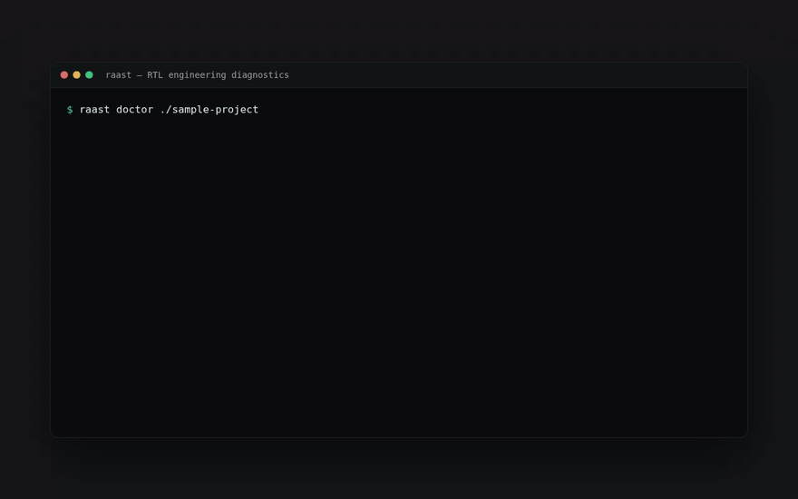

<div align="center">
  
</div>

<div align="center">

**Build RTL right. Everywhere.**

Open-source RTL engineering for AI-powered development — Persian, Arabic & Hebrew first, with Spanish as the first LTR host.

[](https://github.com/mhmdsdqi87-cloud/TEKA_raast/actions/workflows/raast.yml) [](https://github.com/mhmdsdqi87-cloud/TEKA_raast/actions/workflows/release.yml) [](#pillar-1--raast-skills-the-intelligence-layer) [](#pillar-2--raast-doctor-cli-the-engineering-layer) [](#language-profiles) [](#pillar-3--raast-benchmark-the-evaluation-layer) [](#real-browser-inspection-runtime-inspector) [](#the-bug-corpus--evidence-first) [](#language-quality-gate--beyond-rtl-pages) [](#test-evidence) [](LICENSE) [](https://mhmdsdqi87-cloud.github.io/TEKA_raast/)

`rtl` · `persian` · `farsi` · `arabic` · `hebrew` · `espanol` · `bidi` · `typography` · `i18n` · `l10n` · `internationalization` · `claude-code` · `claude-skills` · `ai-agents` · `developer-tools` · `linting` · `accessibility` · `right-to-left` · `urdu` · `localization` · `nextjs` · `tailwind`

</div>

---

AI coding agents build beautiful interfaces — and then you open them in Persian or Arabic:

- `letter-spacing` **shatters joined Arabic-script letters**: «مدیریت» renders as م د ی ر ی ت
- Missing **ZWNJ** (`نیم‌فاصله`, U+200C): `«می شود»، «خانه ها»، «خوب تر»`
- Western digits inside Persian copy: "5 ستاره" instead of «۵ ستاره»
- `text-align: left`, physical `margin-left/right`, icons pointing the wrong way
- `$99` scrambling to `99$`, URLs reordering inside RTL sentences
- Fonts without Persian glyph coverage, cramped 1.5 line-height on Arabic script

LLMs *know* some of this — but knowledge without an executable contract does not ship. **RAAST turns RTL correctness into three artifacts that work together: skills that teach the agent, a CLI that verifies the result, and a benchmark that measures the difference.**

<div align="center">
  
</div>

> Real CLI output. The broken page is in [`tests/fixtures/`](tests/fixtures/) — reproduce it yourself in 10 seconds.

<div align="center">

**No install? <a href="https://mhmdsdqi87-cloud.github.io/TEKA_raast/">Open the RAAST Playground →</a>** — paste your HTML/CSS, pick a profile (fa / ar / he / es), get all 17 findings in your browser. Client-side only, nothing uploaded, rule IDs match the CLI 1:1.

</div>

## The three pillars

### Pillar 1 — RAAST Skills (the intelligence layer)

Six focused skills, plain Markdown, zero config — validated against the [Agent Skills](https://github.com/anthropics/skills) frontmatter constraints:

| Skill | Teaches the agent |
|---|---|
| [`rtl-typography`](skills/rtl-typography/SKILL.md) | Font selection (Persian/Arabic catalog), ZWNJ rules with corrected examples, numerals & separators, punctuation, line-height, the letter-spacing ban, copy/paste & selection integrity, and the [normalization decision table](skills/rtl-typography/references/normalization.md) |
| [`rtl-landing`](skills/rtl-landing/SKILL.md) | Full Persian/Arabic landing pages: section order, Toman pricing, semantic HTML, dark/light theming, Jalali copyright year |
| [`rtl-components`](skills/rtl-components/SKILL.md) | Tailwind logical utilities, the icon-flip list, forms/tables/overlays, direction-aware animations, shadcn/ui RTL notes |
| [`rtl-bidi`](skills/rtl-bidi/SKILL.md) | Mixed-direction content: phones, emails, URLs, `$99`, serials/SKUs, code blocks, UGC — with `bdi`/`dir=auto`/`unicode-bidi` recipes |
| [`jalali-dates`](skills/jalali-dates/SKILL.md) | `Intl` fa-IR one-liners, conversion-vs-formatting distinction, relative time, storage conventions, SSR hydration |
| [`rtl-audit`](skills/rtl-audit/SKILL.md) | 20-point review checklist, P0/P1/P2 severities, findings mapped to CLI rule IDs |

Languages: **fa · ar · he** (RTL) and **es** (first LTR host) ship today as machine-readable profiles in [`raast/profiles/`](raast/profiles/); **ur** is designed-in and needs a native-speaker reviewer (see [CONTRIBUTING.md](CONTRIBUTING.md)).

### Language profiles

| Code | Language | Direction | Distinctive rules the profile drives |
|---|---|---|---|
| `fa` | Persian / فارسی | RTL | ZWNJ affix compounds, Persian digits ۰-۹ mandatory, ، ؟ ؛ punctuation, Jalali dates, Toman currency |
| `ar` | Arabic / العربية | RTL | Arabic-Indic digits ٠-٩, regional font catalog, Persian letters rejected as typos |
| `he` | Hebrew / עברית | RTL | Western digits VALID in prose, Latin punctuation valid, gershayim ״ / geresh ׳ / maqaf ־, nikud-aware line-height, letter-spacing **discouraged** (P1, not P0) |
| `es` | Spanish / Español | **LTR host** | Inverted rule engine: RTL runs inside Spanish prose must be isolated (`RTL015`), RTL elements need `dir` (`RTL016`), RAE inverted marks ¿ ¡ checked (`RTL017`), `dir="rtl"` never suggested on `<html>` |

`raast profiles` lists what your installed CLI carries. Profiles are package data — they ship inside the wheel, no repo checkout required.

### Pillar 2 — RAAST Doctor CLI (the engineering layer)

```bash
pip install raast            # from GitHub Releases wheel (v0.2.0+)
# or from source:
pip install -e .             # Python 3.11+, zero dependencies
raast doctor ./your-project              # Persian by default
raast doctor ./your-project --language he
raast doctor ./your-project --language es
```

17 static rules (`RTL001`–`RTL017`) with severity + confidence, evidence-gated so mixed projects stay quiet (a `left:` in a pure-LTR file is *not* flagged):

| Rule | Detects | Sev |
|---|---|---|
| `RTL001/002` | physical `margin/padding-left/right` | P1 |
| `RTL003` | physical `left:/right:` positioning | P2 review |
| `RTL004` | `text-align: left/right` | P1 |
| `RTL005` | non-zero `letter-spacing` on Arabic script | **P0** |
| `RTL006/014` | missing `dir` / `lang` on `<html>` | P0 / P1 |
| `RTL007` | `translate-x` without an RTL twin | P2 review |
| `RTL008` | Tailwind physical utilities (`ml-`, `text-left`, …) | P1 |
| `RTL009/010` | Latin punctuation / Western digits in Arabic prose | P2 |
| `RTL011` | broken ZWNJ compounds (`«می رود»`) | P1 |
| `RTL012` | un-isolated LTR atoms (URL/phone/$) in RTL prose | P2 review |
| `RTL013` | `dir="ltr"` on RTL-script-only content | P0 |
| `RTL015` | un-isolated RTL atoms in Spanish (LTR) prose | P1 |
| `RTL016` | RTL-run element without `dir` in an LTR document | P1 review |
| `RTL017` | missing RAE inverted marks (¿ / ¡) in Spanish prose | P2 review |

```bash
raast doctor . --format github      # Actions annotations
raast doctor . --fail-on P0         # severity gate, exit code
raast fix . --zwnj                  # dry-run diffs first
raast fix . --zwnj --apply          # backups land in .raast-backup/
raast audit .                       # + human-only manual checklist
```

Safe fixes only. Ambiguous code is never rewritten — the [normalization decision table](skills/rtl-typography/references/normalization.md) defines exactly what may transform, per language.

### Pillar 3 — RAAST Benchmark (the evaluation layer)

24 machine-validated cases across 8 categories with 17 validators. The runner **only reports what actually passes** — it cannot fabricate numbers.

- **Condition C (reference)** — human-verified implementations, validated in CI: **24/24** ([results](docs/benchmark-results.md))
- **Conditions A/B (with vs. without skills)** — methodology published, numbers *deliberately not fabricated*; run it on your agent per [docs/benchmark-methodology.md](docs/benchmark-methodology.md)

## Real browser testing

A Playwright suite (Node, Chromium) that runs against any page at **390 / 768 / 1440** viewports:

```bash
cd browser && npm install
node tests/rtl.spec.mjs --target https://your-page.example --label prod
```

Direction, horizontal overflow, computed line-height, tap-target sizes, alt/label wiring, keyboard focus — plus screenshots for human review. It separates **automated failures** from **manual-review signals** from **checks that are not automatable** (glyph fidelity, bidi shaping — no fake claims). During development this suite found real sub-40px tap targets in our own pages; the finding→fix→green loop is the workflow.

## GitHub Action

```yaml
- uses: mhmdsdqi87-cloud/TEKA_raast/action@main
  with:
    language: fa
    fail-on: P0
```

No secrets required. Annotations appear on the PR; the gate is your severity choice. Full example: [`.github/workflows/raast.yml`](.github/workflows/raast.yml).

## Real browser inspection (Runtime Inspector)

Static analysis cannot see rendered geometry. The Runtime Inspector renders your page in headless Chromium, collects per-element geometry, **flips the document direction and measures again** — elements that fail to mirror, overflow, clip text, keep unflipped arrows, or mix scripts without bidi isolation are reported with a stable selector, screenshots and a suggested fix (`RT001`–`RT006`):

```bash
pip install 'raast[runtime]' && playwright install chromium
raast-inspect inspect --url https://your-page.example --out report \
    --viewport 375x667 --viewport 1280x800
```

Output per run: `report.md`, `report.json`, and before/after-mirror screenshots. Every finding carries severity, the element selector, and the fix. Full rule table and honest limitations: [docs/runtime-inspector.md](docs/runtime-inspector.md).

## PR review that only reports what changed

The bundled [`pr-review` workflow](.github/workflows/pr-review.yml) scans **only the lines changed in a pull request** (merge-base diff ranges), so adopting RAAST in a legacy codebase never produces a wall of pre-existing issues. A PR adding `margin-left: 20px; text-align: left;` gets one comment:

> **RAAST RTL Review**
> P1 — RTL001 · `src/components/Card.css` · line 2 — physical margin declaration
> **Suggested fix:** `margin-inline-start: 20px`

The comment updates in place on every push (marker-based, no spam), and findings gate the exit code at your chosen severity — add the workflow as a required status check to block merges. Anatomy and setup: [docs/pr-review.md](docs/pr-review.md).

## Auto-Fix 2.0 — three tiers, fully reversible

| Tier | Behavior | Example |
|---|---|---|
| **Safe** | applied automatically | `margin-left: 16px` → `margin-inline-start: 16px` |
| **Suggested** | opt-in (`--tier all` + language flags) | Western digits → Persian digits in fa prose |
| **Manual** | listed, never rewritten | positioning semantics, `dir` placement, icon intent |

Every apply writes backups plus a machine-readable fix journal; `raast revert --yes` restores byte-identical originals. Policy and rationale: [docs/auto-fix.md](docs/auto-fix.md).

## The bug corpus — evidence-first

32 reproducible RTL defect specimens across 8 categories (css-direction, bidi, typography, components, forms, tables, icons, responsive) — each with `broken.html`, `fixed.html`, a **machine-verified rule-hit check** (`tools/corpus/verify.py`, 32/32 PASS; every fixed page must scan clean) and Chromium-rendered before/after screenshots. Every specimen is labeled `lab-verified`; the corpus policy separates lab reproductions from real-world reports, and none of the latter ship yet. Browse: [corpus/](corpus/README.md).

## Language quality gate — beyond RTL pages

```bash
raast-i18n scan --locales ./locales --source en --max-errors 0
```

Scans locale files for missing keys, empty values, placeholder mismatches (`{name}`, `{{name}}`, `%s`, `%1$s`), untranslated strings, length anomalies, Western digits / Latin punctuation in Arabic-script prose, un-isolated Latin runs in RTL values, Arabic Yeh/Kaf in Persian text, and opt-in Hebrew niqqud (rules `LQG001`–`LQG009`). Exit-code gates CI. Check table: [docs/i18n-gate.md](docs/i18n-gate.md).

## Compatibility matrix — generated, not claimed

Eight framework fixtures (vanilla CSS, CSS Modules, Tailwind, Bootstrap, React JSX, Next styled-jsx, Vue SFC, Spanish LTR host) are scanned by the real engine; [docs/compatibility-matrix.md](docs/compatibility-matrix.md) is **generated from those runs** and CI fails if the doc is stale (`tools/compat/run_matrix.py --check`). Per-stack limitations are stated on the matrix itself.

## VS Code

[`vscode-raast/`](vscode-raast/README.md) runs the installed CLI on save and publishes findings in the Problems panel (P0 → Error, P1 → Warning, P2 → Information) with quick fixes for safe-tier rules. Scaffold with build instructions; requires `pip install raast`.

## Works with your agent

The same RTL contract, in each tool's native instruction format — copy one file:

| Agent | Drop-in |
|---|---|
| **Claude Code** | six skills → `~/.claude/skills/` (deepest playbooks) |
| **Codex CLI** / agents.md tools | [`integrations/AGENTS.md`](integrations/AGENTS.md) → repo root |
| **GitHub Copilot** | [`integrations/copilot-instructions.md`](integrations/copilot-instructions.md) → `.github/copilot-instructions.md` |
| **Cursor** | [`integrations/cursor-rtl.mdc`](integrations/cursor-rtl.mdc) → `.cursor/rules/rtl.mdc` |

All four carry the same 8 hard rules + Tailwind/icon policy + `Intl` dates + the verify step. Details and honest status per environment: [integrations/README.md](integrations/README.md), [docs/compatibility.md](docs/compatibility.md).

## Install & quick start

```bash
git clone https://github.com/mhmdsdqi87-cloud/TEKA_raast.git
cp -r TEKA_raast/skills/* ~/.claude/skills/     # skills for Claude Code
cd TEKA_raast && pip install .                  # the CLI (real install — wheel ships profiles)
raast doctor benchmarks/reference --fail-on P0  # sanity check → exit 0
```

Anything that ingests Markdown can use the skills; verified environments and honest status of everything else: [docs/compatibility.md](docs/compatibility.md).

## Test evidence

```
$ python3 -m unittest discover -s tests
Ran 80 tests in 0.5s — OK

$ raast benchmark --cases benchmarks/cases --candidate benchmarks/reference --condition C-reference
passed 24/24, failed 0, skipped 0

$ python3 tools/corpus/verify.py
32/32 specimens PASS, 0 FAIL

$ raast profiles
available language profiles:
  ar   العربية    Arabic       (rtl)
  es   Español    Spanish      (ltr)
  fa   فارسی      Persian      (rtl)
  he   עברית      Hebrew       (rtl)

$ raast doctor demo --fail-on P0
Summary: 1 finding(s): 0 P0, 0 P1, 1 P2      # exit 0
```

The unit suite covers Unicode edge cases: ZWNJ joins and their *non*-joins (possessive suffixes stay attached), Arabic-Indic digits blocked from conversion in `ar`, Western digits staying valid in `he`/`es` prose, Hebrew `letter-spacing` downgrade to P1, Spanish RTL-run isolation and inverted-mark checks, code-fence protection, config schema validation, scanner globs, end-to-end CLI runs including the backup/restore path — plus packaging regression tests that load every profile from the installed wheel's package directory.

## Documentation

| | |
|---|---|
| [Getting started](docs/getting-started.md) | [Installation](docs/installation.md) |
| [CLI reference](docs/cli-reference.md) | [Troubleshooting](docs/troubleshooting.md) |
| [Benchmark methodology](docs/benchmark-methodology.md) | [Benchmark results](docs/benchmark-results.md) |
| [Architecture audit](docs/architecture-audit.md) | [Compatibility](docs/compatibility.md) |
| [Compatibility matrix](docs/compatibility-matrix.md) | [Runtime Inspector](docs/runtime-inspector.md) |
| [PR review](docs/pr-review.md) | [Auto-fix policy](docs/auto-fix.md) |
| [i18n gate](docs/i18n-gate.md) | [Bug corpus](corpus/README.md) |
| [Roadmap](docs/implementation-roadmap.md) | [Release checklist](docs/release-checklist.md) |

## What RAAST is not

- **Not a Persian-only prompt pack** — machine-readable profiles separate language conventions from rules.
- **Not a star-maximization project** — no fabricated metrics; A/B claims require controlled runs you can reproduce.
- **Not a visual-perfect scanner** — static analysis plus browser checks approximate truth; screenshots accompany every claim.

## Roadmap

- **v0.2** ✅ **shipped** — Hebrew profile (full rules), Spanish LTR host profile (RTL015–017), packaging hardening (`py.typed`, zip-safe profile loading, graceful `ProfileError`, `raast profiles` command), 80-test suite
- **v0.3** ✅ **shipped** — RAAST Playground (browser audit, all 17 rules client-side, GitHub Pages); agent integration files for Codex CLI (`AGENTS.md`), GitHub Copilot (`.github/copilot-instructions.md`) and Cursor (`.cursor/rules/*.mdc`)
- **v0.4** ✅ **shipped** — Runtime Inspector (Playwright LTR/RTL mirror diff, RT001–006); diff-scoped PR reviewer with idempotent PR comments; Auto-Fix 2.0 (safe/suggested/manual tiers + fix journal + `raast revert`); 32-specimen bug corpus with machine-verified evidence; Language Quality Gate (LQG001–009); generated compatibility matrix; VS Code extension scaffold
- **v0.5** — Urdu profile after native-speaker review; email-client and PDF categories; `.po`/`.arb` locale formats for the i18n gate; camelCase CSS-in-JS coverage (the lexical engine currently matches kebab-case only — documented on the compatibility matrix); Claude Code plugin manifest + marketplace flow

## Contributing

PRs welcome — rules with false-positive tests, benchmark cases, and **language profiles from native speakers** are the highest-value contributions. Read [CONTRIBUTING.md](CONTRIBUTING.md); releases follow [docs/release-checklist.md](docs/release-checklist.md). This project follows its [Code of Conduct](CODE_OF_CONDUCT.md); security issues go to [SECURITY.md](SECURITY.md).

## License

[MIT](LICENSE) — referenced fonts carry their own open licenses (OFL or equivalent).

<div align="center">
  <a href="https://star-history.com/#mhmdsdqi87-cloud/TEKA_raast&Date">
    <picture>
      <source media="(prefers-color-scheme: dark)" srcset="https://api.star-history.com/svg?repos=mhmdsdqi87-cloud/TEKA_raast&type=Date&theme=dark" />
      
    </picture>
  </a>
  <sub><br>raast (راست) — "right / straight / correct" in Persian. Built because Persian and Arabic users deserve interfaces that read like a native designer made them.</sub>
</div>
